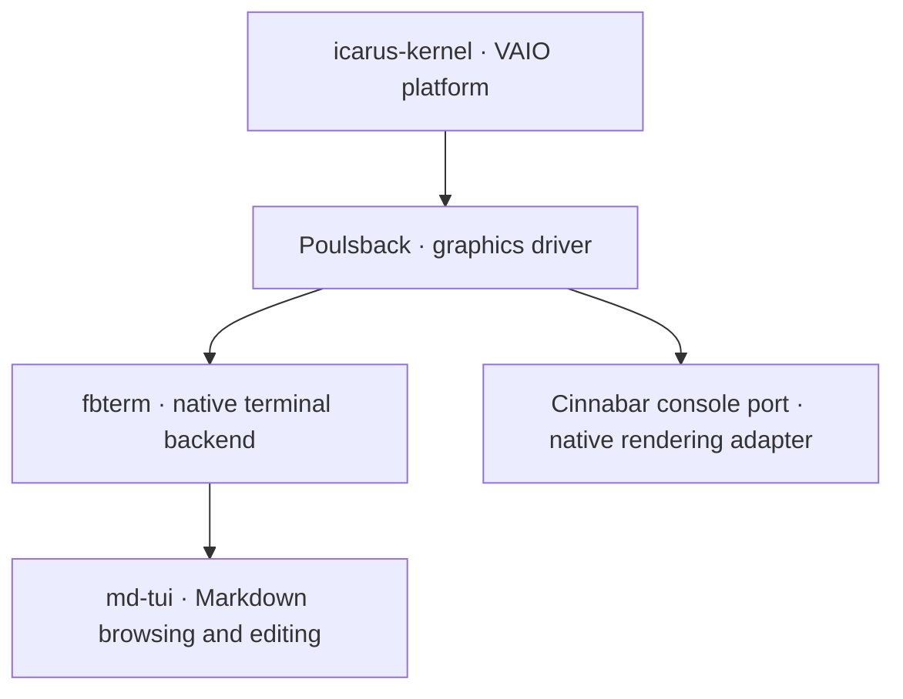

# Section 9 Workflows

Linux console tools, native graphics, and hardware-specific kernel work.
Much of this work targets the Sony VAIO P: an Atom-based machine with Intel
GMA 500 graphics and a 1600×768 display. The projects explore how much useful
work and play can fit on that platform without a desktop environment.

## Projects

| Project | What it does | Work in this organization |
| --- | --- | --- |
| [icarus-kernel](https://github.com/Section-9-Workflows/icarus-kernel) | A 32-bit Linux kernel configuration and build recipe for the VAIO P. | PREEMPT_RT, VAIO device support, explicit Atom compiler targeting, and kernel/module packaging. |
| [poulsback](https://github.com/Section-9-Workflows/poulsback) | An experimental Linux graphics driver for Intel GMA 500 / 600. | A fork for VAIO-focused driver changes and upstream contributions, including panel handling, graphics initialization, and sleep/resume work. |
| [fbterm](https://github.com/Section-9-Workflows/fbterm) | A Linux framebuffer terminal with font rendering, scrollback, and multiple windows. | Console fixes and a [native Poulsback backend](https://github.com/Section-9-Workflows/fbterm/tree/poulsback-native), including GPU-assisted scrolling without X or Wayland. |
| [md-tui](https://github.com/Section-9-Workflows/md-tui) | A keyboard-driven Markdown reader with links, a file tree, search, and external-editor support. | [Console-oriented changes](https://github.com/Section-9-Workflows/md-tui/tree/icarus) for document-relative links, screen clearing, a compact help footer, and i686 builds. |
| [cinnabar](https://github.com/Section-9-Workflows/cinnabar) | An independent Minecraft: Bedrock Edition client. | An experimental [native console port](https://github.com/Section-9-Workflows/cinnabar/tree/poulygon/native-client) that connects shared game/session logic to flat-shaded graphics through Poulsback. |

## How they fit together

The kernel recipe supplies the VAIO platform configuration. Poulsback provides
native graphics interfaces on top of Linux. There are two application paths:
a framebuffer terminal for everyday text work, and a direct rendering path for
the experimental game client.

This shows how the projects can be used together, rather than a list of mandatory
software dependencies. md-tui also runs in other terminals, fbterm retains its
ordinary framebuffer backend, and Poulsback can be built for other supported
kernel configurations. Cinnabar's upstream desktop client is separate from the
console port.

## Following the work

The links above lead to the relevant fork branches where appropriate. Default
branches may still follow upstream, and an experimental branch is not a release.
The Cinnabar console port has account setup, world loading, movement and a
provisional HUD/chat interface; full gameplay and presentation remain unfinished.
See its [implementation checklist](https://github.com/Section-9-Workflows/cinnabar/blob/poulygon/native-client/docs/poulygon-playable.md)
for the remaining work. It requires a licensed copy of Minecraft and ships no
game assets.

Build results and hardware results have different scopes. Each repository's
instructions and validation notes describe what has actually been checked.

## Upstream projects

These forks build on [Poulsback](https://github.com/ishad0w/poulsback),
[FbTerm](https://github.com/sfzhi/fbterm),
[MD-TUI](https://github.com/henriklovhaug/md-tui), and
[Cinnabar](https://github.com/cinnabar-mc/cinnabar). Their authorship, licenses,
and contribution processes remain with those projects. Focused fixes are kept
separate where practical so they can be reviewed upstream.

This page is maintained in [`.github`](https://github.com/Section-9-Workflows/.github).
